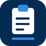
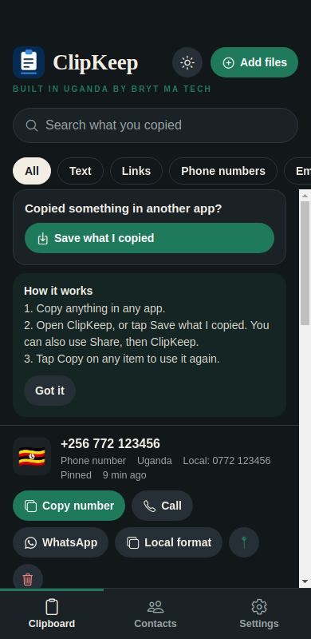

# ClipKeep

**Everything you copy, kept.**
A clipboard for your PC and your phone that understands phone numbers, emails and colours.

&nbsp;

[Windows portable (no install)](https://github.com/muhumuza684/clipkeep/releases/latest/download/ClipKeep-Portable.exe) &nbsp;|&nbsp; [User guide](docs/GUIDE.md) &nbsp;|&nbsp; [All releases](https://github.com/muhumuza684/clipkeep/releases)

Built in Uganda by [Bryt Ma Tech](https://github.com/muhumuza684). Everything stays on your device. No account, no cloud, no internet needed.

## Why ClipKeep

- **It keeps everything.** Text, links, images, files, audio and video, saved the moment you copy them.
- **It understands what you copied.** Phone numbers get a country flag and a WhatsApp button. Emails and colours get their own buttons.
- **It builds your contacts for you.** Every number and email you copy is collected by country.
- **Every action is a labelled button.** No hidden keys. Delete has Undo.
- **A normal window that stays open.** Close it and ClipKeep keeps saving from the tray.
- **Yours to style.** Light, dark, and any accent colour.

## Get it

| Platform | Download | Notes |
|---|---|---|
| **Windows 10 or 11** | [ClipKeep-Setup.exe](https://github.com/muhumuza684/clipkeep/releases/latest/download/ClipKeep-Setup.exe) | Installer. Press **Ctrl+Alt+V** from any app to bring it forward. |
| **Windows, no install** | [ClipKeep-Portable.exe](https://github.com/muhumuza684/clipkeep/releases/latest/download/ClipKeep-Portable.exe) | Double-click to run. |
| **Android** | [ClipKeep.apk](https://github.com/muhumuza684/clipkeep/releases/latest/download/ClipKeep.apk) | Allow "install from this source" when asked. |

The apps are not code-signed yet. Windows may say "Windows protected your PC": choose **More info**, then **Run anyway**. Step-by-step help is in the **[User guide](docs/GUIDE.md)**.

## What it does

| | Windows | Android |
|---|:---:|:---:|
| Saves text, links, images, files, audio and video | Yes | Yes |
| Phone numbers with country flag and WhatsApp | Yes | Yes (and Call) |
| Emails and colours with their own buttons | Yes | Yes |
| Contacts collected by country | Yes | Yes |
| Emoji picker | Yes | |
| Colour picker with screen eyedropper and palettes | Yes | |
| Country flags finder with dial codes and currencies | Yes | |
| Light, dark and your own accent colour | Yes | Yes |
| Undo after delete | Yes | Yes |
| Open with Win+V (optional) | Yes | |
| Quick Save button in the notification area (optional) | | Yes |

## Screenshots

| Contacts by country | Emoji | Colours |
|---|---|---|
|  |  |  |

| Phone | Contacts | Dark | Accent colour |
|---|---|---|---|
|  |  |  |  |

## Questions

**Can ClipKeep be my default clipboard?**
Neither Windows nor Android has a "default clipboard" setting, so no app can ask for it. On Windows, ClipKeep saves everything while it runs, and you can optionally take over **Win+V** in Settings. On Android, the system only lets an app read the clipboard while it is open, so ClipKeep offers a **Save what I copied** button, **Share, then ClipKeep**, and an optional **Quick save** button in your notifications. Details are in the [User guide](docs/GUIDE.md).

**Is my data private?**
Yes. Everything is stored on your own device. There is no account, no server and no tracking. Copies from password managers that mark them private are skipped, and you can block your own patterns.

**Something does not work.**
Please [open an issue](https://github.com/muhumuza684/clipkeep/issues) and say what you did and what happened. A screenshot helps.

## Status

An early release, still being tested on more devices. The phone app has no emoji, colour or flags tabs yet, and there is no syncing between devices.

## For developers

Build, test and release instructions are in **[docs/DEVELOPING.md](docs/DEVELOPING.md)**.

## Contact

Bryt Ma Tech, Uganda. Software you can trust.
Email: muhumuzabright26@gmail.com
