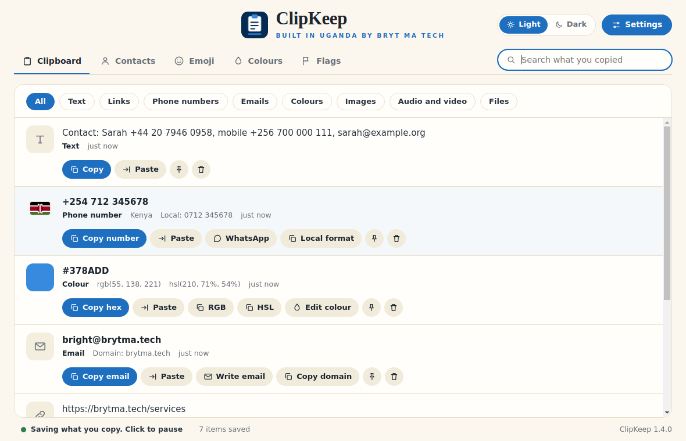
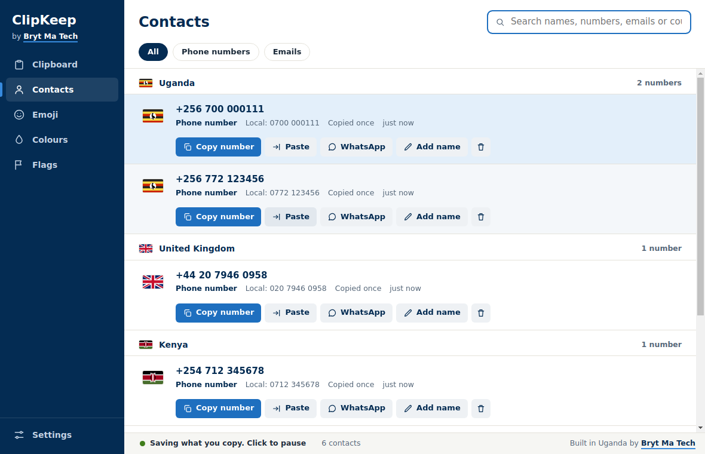
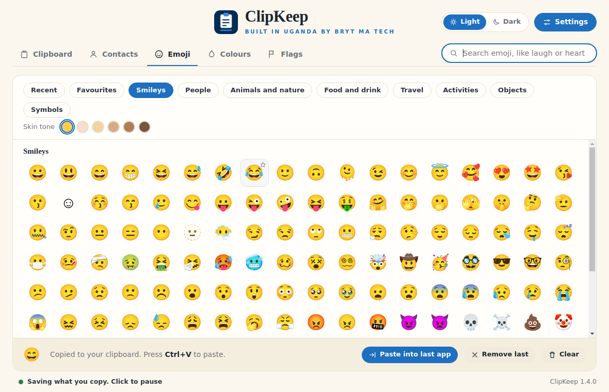
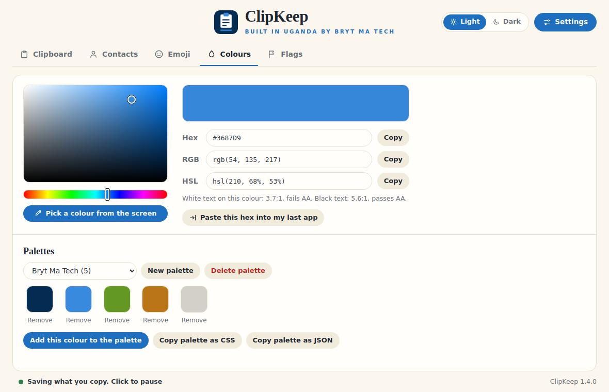
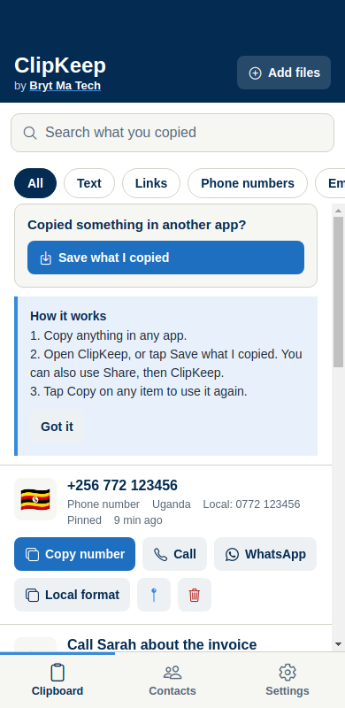
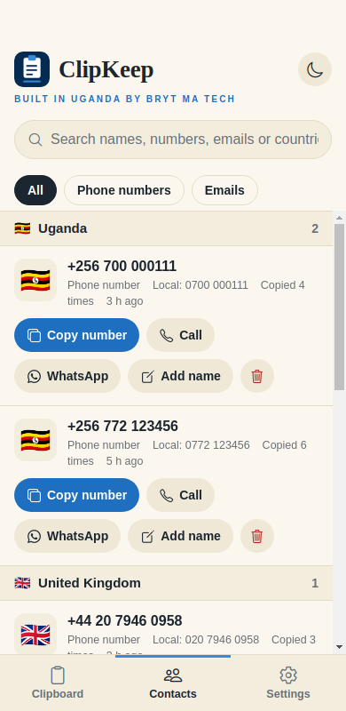
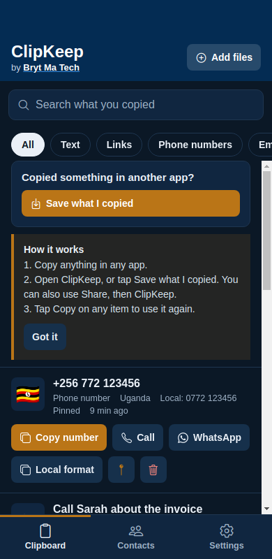
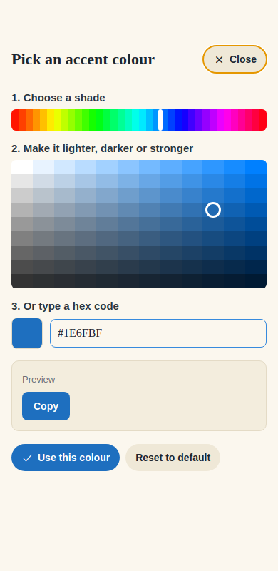

# ClipKeep

**A clipboard for your PC and your phone that keeps everything you copy, understands phone numbers, emails and colours, and finds it all again.**

Built in Uganda by [Bryt Ma Tech](https://github.com/muhumuza684). Everything stays on your device. No account, no cloud, no internet needed.

## Download

| | |
|---|---|
| **Windows installer** (recommended) | [ClipKeep-Setup.exe](https://github.com/muhumuza684/clipkeep/releases/latest/download/ClipKeep-Setup.exe) |
| **Windows portable** (no install) | [ClipKeep-Portable.exe](https://github.com/muhumuza684/clipkeep/releases/latest/download/ClipKeep-Portable.exe) |
| **Android** | [ClipKeep.apk](https://github.com/muhumuza684/clipkeep/releases/latest/download/ClipKeep.apk) |

All versions are on the [Releases page](https://github.com/muhumuza684/clipkeep/releases).

**Windows 10 and 11 (64-bit).** The app is not code-signed yet, so Windows SmartScreen may say "Windows protected your PC" the first time. Choose **More info**, then **Run anyway**.

**Android.** Open the downloaded file and allow "install from this source" when asked. The APK is not from the Play Store.

## What it does



- **A normal window that stays open.** It never disappears when you click elsewhere. Closing it keeps it in the tray so it keeps saving.
- **Every action is a labelled button.** Copy, Paste, Pin, Delete, and the buttons that fit what you copied. No hidden keys. Delete has Undo.
- **Understands what you copy.**
  - Phone numbers get a country flag, a WhatsApp button and a Local format button. A number like `0772 123456` is read as Ugandan (you can change your country).
  - Emails get Write email and Copy domain.
  - Colours (`#378ADD`, `rgb(...)`, `hsl(...)`) get a swatch and Copy hex, RGB and HSL.
- **Contacts, collected for you.** Every number and email you copy is kept, even ones inside a longer message, grouped by country.
- **Emoji, colours and flags.** An emoji picker with search and skin tones, a colour picker with a screen eyedropper and palettes, and a country flags finder with dial codes and currencies (Windows).
- **Your look.** Light, dark or follow the device, plus your own accent colour.
- **Private by design.** Copies from password managers that mark them private are skipped, and you can block your own patterns.

| Contacts by country | Emoji | Colours |
|---|---|---|
|  |  |  |

### On your phone

| Clipboard | Contacts | Dark with your colour | Colour picker |
|---|---|---|---|
|  |  |  |  |

Android only lets an app read the clipboard while it is open. After copying in another app, open ClipKeep (it saves automatically) or tap **Save what I copied**. You can also use **Share, then ClipKeep** for text, images, audio, video and files.

## Status

This is an early release. The automated checks and previews pass, but it needs more testing on real devices. If something does not work, please [open an issue](https://github.com/muhumuza684/clipkeep/issues) and say what you did and what happened.

Known limits: the phone app has no emoji, colour or flags tabs yet and no keyboard that shows your history inside other apps; there is no syncing between devices; the Windows Paste button does not work into windows running as administrator.

## Build it yourself

You need [Node.js](https://nodejs.org) 20 or newer.

**Windows app** (in `windows/`)
```
cd windows
npm install
npm start          # run it
npm test           # run the tests
npm run dist       # build the installer into windows/dist
```

**Android app** (in `phone/`)
```
cd phone
npm install
npx expo start     # scan the QR code with Expo Go
npx expo run:android   # a development build, needed for the Share menu
```

Names, tagline and contact lines are in `windows/brand.js` and `phone/src/brand.js`.

## Make a release (for maintainers)

Pushing a version tag builds the apps and publishes them on the Releases page:

```
git tag v1.3.3
git push origin v1.3.3
```

The **Release** workflow creates the release, builds the Windows installer and portable app, builds the Android APK, and attaches them. The Android build is marked optional, so a problem there never blocks the Windows release; you can re-run it from the Actions tab.

## Project layout

```
windows/   Electron app for Windows
phone/     Expo (React Native) app for Android
docs/      Screenshots used in this README
.github/   Build checks and the release workflow
```

## Contact

Bryt Ma Tech, Uganda. Software you can trust.
WhatsApp +256 759 621 612 · TikTok @brytmatech
